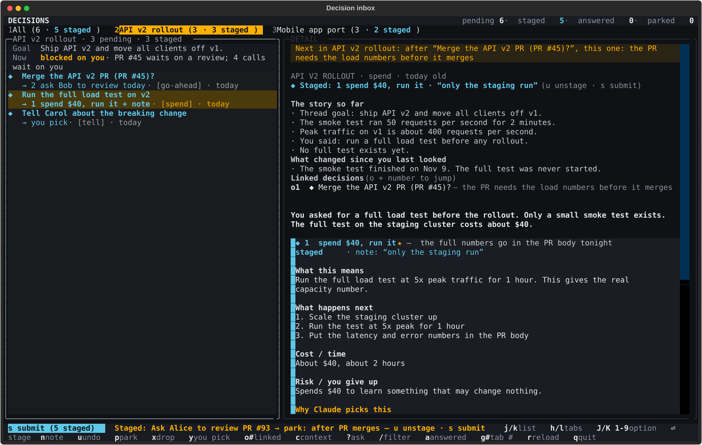

# houston

*Houston, we have a decision.*

One inbox for every decision your Claude Code sessions need from you.

When you run many sessions, questions for you get buried in long replies,
footers and "see open items in file X". With this plugin, each session logs
its decisions in one store. You answer them in batch in a terminal inbox.
Your answers flow back to the session that asked.



## Install

```sh
claude plugin marketplace add jjshoots/houston
claude plugin install houston@houston
```

(Inside Claude Code: `/plugin marketplace add jjshoots/houston`, then
`/plugin install houston@houston`.) Restart open sessions to load it.
The inbox needs [uv](https://docs.astral.sh/uv/); everything else runs on
plain `python3`.

## Uninstall

```sh
claude plugin uninstall houston@houston
claude plugin marketplace remove houston
```

If you installed the terminal command, also run `uv tool uninstall houston-inbox`.
Your decisions stay in `~/.claude/houston`. Delete that folder to remove
them.

## Open the inbox

The plugin puts `houston` on the PATH of Claude's Bash tool only. For your
own terminal, install the same code as a Python tool:

```sh
uv tool install git+https://github.com/jjshoots/houston   # install
uv tool upgrade houston-inbox                              # upgrade
uv tool uninstall houston-inbox                            # uninstall
```

Then run `houston`. Both routes use the same store (`~/.claude/houston`,
or `HOUSTON_HOME`). If your shell cannot find `houston`, run
`uv tool update-shell` once.

## Keys

| Key | Does |
|---|---|
| `h` / `l`, `g`+digit | change thread tab |
| `j` / `k` | move in the list |
| `J` / `K`, `1`-`9` | move the option cursor |
| `enter` | stage the option (nothing is sent yet) |
| `n` | add a note to the pick |
| `p` / `x` / `y` | stage park / drop / "you pick" (Claude decides) |
| `s` | review all staged picks, `enter` sends them as one batch |
| `u` | unstage, or undo the last batch |
| `c` | show the conversation the question came from |
| `?` | ask a question about the decision (a headless Claude answers) |
| `o`+digit | jump to a linked decision |
| `/` | filter · `a` show answered · `r` reload · `q` quit |

The last two option rows are always "Write my own answer" and "Explain this
better" (Claude rewrites the decision and it comes back to you).

## How sessions use it

The plugin adds a `houston` skill (`/houston:houston`) and three hooks:

- **Skill**: tells Claude when to log a decision (a choice, a go-ahead, a
  spend, a "later", a message for someone else, something it decided alone)
  and how: `houston add < decision.json`, with options that each state their
  consequence, cost and risk, and one starred pick.
- **SessionStart / UserPromptSubmit hook**: shows the session your
  answers it has not taken yet, until it runs
  `houston answers --session <id> --mark-delivered`.
- **Stop hook**: if a reply asks you to decide but logged nothing, Claude is
  sent back once to log it.

CLI: `houston add | threads | thread set | list | show | update | close |
answers | doctor`. Run `houston <command> --help`.

Messages call you "the user". To use a name, set `HOUSTON_USER_NAME`, or put
`{"user_name": "Sam"}` in `~/.claude/houston/config.json`.

## Turn the stop hook off

Set `HOUSTON_STOP_HOOK=off` in the environment Claude Code runs in (for
example in `~/.claude/settings.json` under `"env"`). `HOUSTON_HOOKS_OFF=1`
turns off all houston hooks. Or disable the whole plugin:
`claude plugin disable houston@houston`.

## Tests

```sh
uv run --no-project --with textual --with pytest --with pytest-asyncio pytest
```

MIT. See `LICENSE`.
